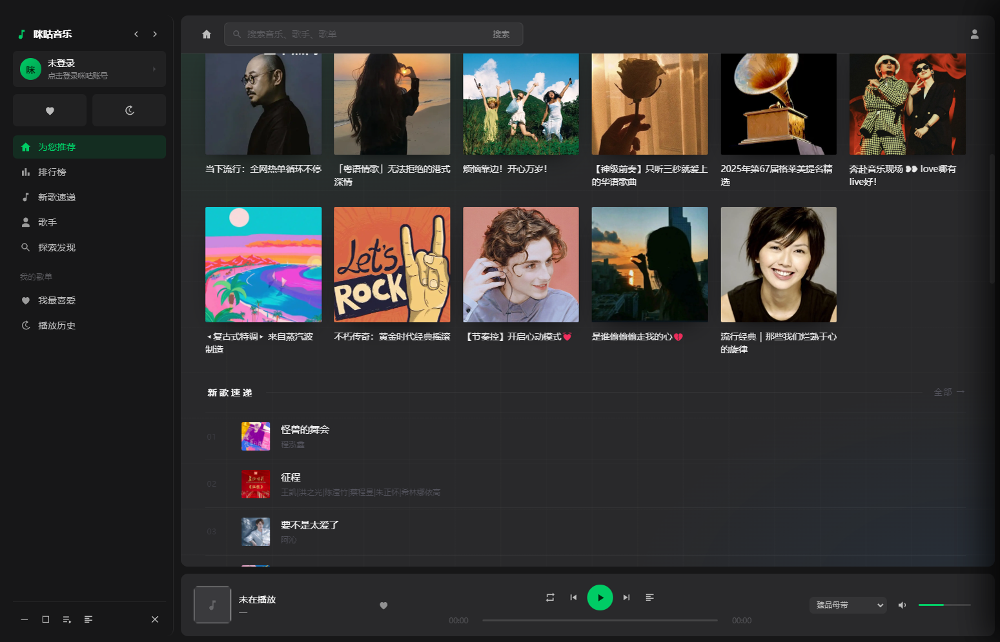
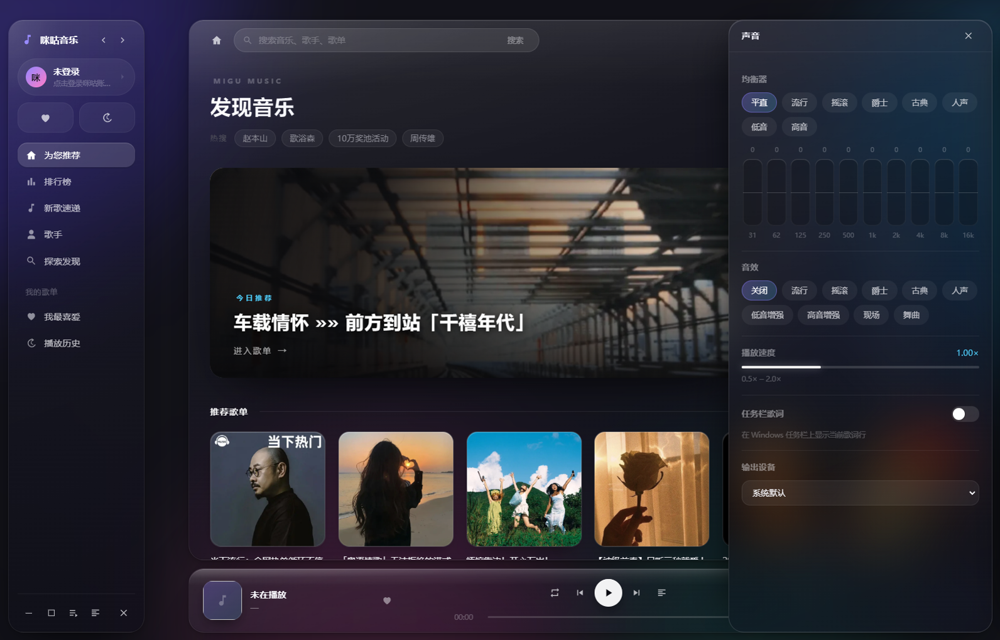
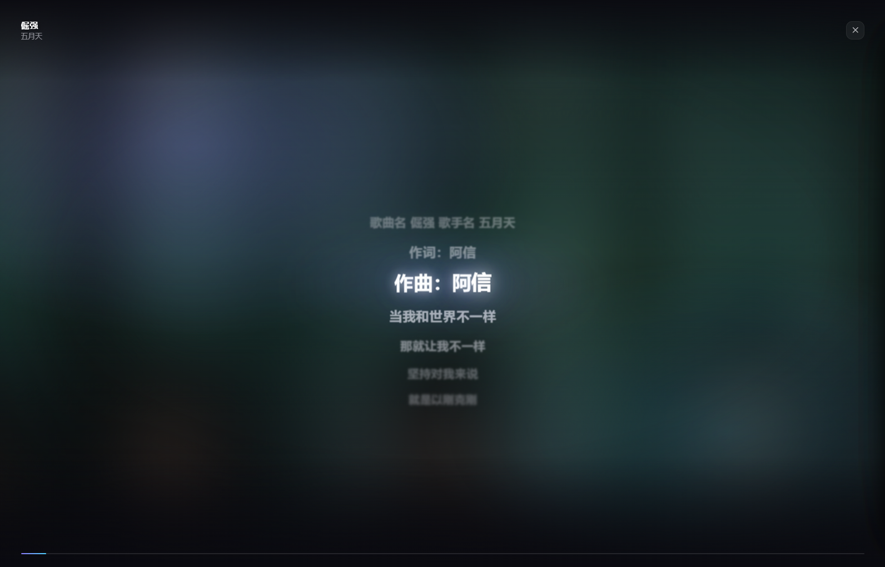

# 咪咕音乐 桌面版

[](https://github.com/SSenjiahui/Mg-pc/releases/latest)
[](https://github.com/SSenjiahui/Mg-pc/releases/latest)
[](https://www.electronjs.org/)
[](LICENSE)

把咪咕音乐（手机端的在线音乐服务）搬到 Windows 桌面上的第三方 Electron 客户端。
自绘标题栏、深色主题、无边框窗口，直接对接咪咕音乐的 Web 接口，界面与交互为自建实现。


<sub>上图摘自 Release 包实际运行窗口（1500×950，2026-11-19 验证）</sub>







## 特性

| 模块 | 说明 |
| --- | --- |
| 界面外壳 | 仿 EchoMusic 2.3.2 的三面板布局：窗口底色 `#171718` + 侧栏 / 主区 / 播放条三块 10px 圆角面板，8px 外边距、10px 缝隙；主色 `#00cc65` |
| 发现音乐 | 今日推荐大图 + 快捷入口 + 推荐歌单墙 + 新歌行列表 + 三列榜单 + 新碟 + 每日推荐；**接口层直接过滤广告位** |
| 排行榜 | 5 个官方榜（国风热歌、音乐风向、尖叫新歌、尖叫热歌、尖叫原创），点进去是 100 首榜单详情 |
| 新歌速递 | 按发行时间分页拉取 |
| 歌手 | 歌手分类 Tab、歌手详情（粉丝数/歌曲数/专辑数）、专辑列表、热门歌曲 |
| 搜索 | 单曲/歌手/专辑/歌单四类，输入即时建议，回车搜索，结果分页 |
| 歌单 / 专辑 | 详情页含简介、曲目表、播放全部 |
| 我的音乐 | 收藏与最近播放，本地持久化 |
| 播放器 | 播放/暂停、上/下一首、进度拖拽、音量、循环模式（列表/单曲/随机） |
| **沉浸式歌词** | 全屏歌词层，行/字/面板三级弹簧动画，逐字点亮，长行跑马，离场遮罩 |
| 队列面板 | 右侧抽屉，当前曲高亮，点击切歌 |
| 音质 | 标准 PQ / 高清 HQ / 无损 SQ，切换后立即重载当前曲，无权限自动回落 |
| 快捷登录 | 内嵌 passport 窗口完成登录，自动抓取 Cookie 并落盘 |
| 快捷键 | `Space` 播放暂停 · `Ctrl+←/→` 上/下一首 · `Esc` 收起面板 |
| 原生播放内核 | 走 FFmpeg + WASAPI（napi），不由 Chromium 解码 |
| 无广告 | `getHome()` 过滤 `txt === '广告'` 与 `mgmusic://browser?url=` 外链推广项，整块丢弃 `ZJ-Banner-V` |

## 技术要点

### 为什么不用 `<audio>`

Chromium 只能解 RIFF/fLaC/MP3/Ogg/MP4 这几类容器。咪咕「臻品」档位下发的东西
（几十 MB 的 3D WAV、伪装扩展名的封装）它一律 `readyState = 0`，表现就是进度条不动、
反复重取。所以播放链路是：

```
渲染层 audio 门面 → IPC: player:load/play/pause/seek → 主进程 player.js
                                                       → native/echo-ffmpeg-player.node
```

`src/renderer/app.js` 里维护了一个 `audio` 门面对象（`src`、`currentTime`、`paused`、
`play()`、事件派发），把原生内核推回来的 `time-update` / `state-change` / `playback-end`
翻译成同名 DOM 事件，渲染层其余代码完全无感。

### 请求与响应解密

接口响应体是自定义混淆格式，首字节 `0xAB 0xCD 0x01`：

```
seed     = buf[3]
plain[i] = (buf[4 + i] + seed - key[i % key.length]) & 0xFF
```

key 表按请求类型分组，常量定义在 `src/main/migu-api.js`（逆向自咪咕 Web 端 SDK）。
解出明文后按 gzip/deflate 解压再转 UTF-8。**这些常量随服务端改版而失效，属于已知脆弱点。**

### 可播性判断

`canListen` 返回的 `vip` 标志与实际能否播放无关，`limitLength` 才是可靠信号：

| 歌曲 | vip | limitLength | 实际 url |
| --- | --- | --- | --- |
| 晴天 | true | true | 无（440013，可试听 60s） |
| 晴天 (Live) | true | false | 有 |
| 倔强 | true | false | 有 |
| 倔强 (Live) | true | true | 无 |

队列预检用 `!canListen || limitLength` 判不可播，列表行灰显。

### 不可播放提示条

拿不到 url 时不黑屏、不静默失败：清空 src 重置进度条 → 按 `cannotCode` 弹底部提示条
（`440013` 会员 / `440022` 音质权限 / 其它）→ 副文案取 `dialog || cannotMsg`，
末附「可试听 N 秒」→ 9 秒自动消失，提供「去开通 / 下一首 / 关闭」→
队列里还有别的歌时 1.4 秒后自动跳下一首（`S.blockedRun` 防死循环）。

## 沉浸式歌词

一层独立的 DOM 舞台，不与主界面共享布局，开关时整层淡入淡出。

- **三级弹簧**（半隐式欧拉积分，参数取自参考实现的原始数值）：

  | 对象 | stiffness | damping | mass |
  | --- | --- | --- | --- |
  | 行（line） | 142 | 28 | 0.82 |
  | 字（glyph） | 240 | 21 | 0.72 |
  | 面板（stage） | 130 | 24 | 0.9 |

- **逐字时间轴**：优先用 QRC / MRC 的 `<ms,dur>` 标记；其次是增强 LRC 的
  `<mm:ss.xx>字`；两者都没有时，按 CJK 单字 / 拉丁按词、结合标点与词长权重
  把行时长分配到每个字，最后才退回按行进度均分扫光。
- **token 化**：CJK 逐字、拉丁按词、标点独立成 token；长行超过视口宽度时切换为跑马模式。
- **视差**：指针移动带动整层轻微位移，`prefers-reduced-motion` 下自动关闭。
- **seek 立即同步**：`setTime()` 在行索引变化时直接 `snapWindow()` 把窗口内所有行
  的位置/透明度/模糊一次到位、不跑弹簧，避免大跨度拖动进度后画面滞后一帧。

相关文件：`src/renderer/lattice-lyrics.js`、`lattice-lyrics.css`、`errors.js`。

## 界面：液态玻璃（Liquid Glass）

不是"深色 + 卡片"，而是三层材质叠出来的液态玻璃：

| 层 | 作用 | 实现 |
| --- | --- | --- |
| `.glass-field` | 光场——唯一"实"的东西 | 四团 52/46/44/34vw 色斑（紫 / 青 / 洋红 / 薄荷），`blur(64px) saturate(112%)`，28–46s 循环漂移 |
| `.panel` / `.sidebar` | 玻璃板 | `backdrop-filter: blur(46px) saturate(142%) brightness(1.06)` + 深色 34% tint + 顶底双向 inset 阴影做厚度 |
| `.glass-specular` | 棱边高光 | 左上角 `radial-gradient` 白 + 顶部 12% 渐隐，`mix-blend-mode: screen` |

配色刻意避开 EchoMusic 的灰 + 绿，改用：

```
--spec-1 #8b7cff   冷紫（主）
--spec-2 #4fd1ff   冰青（次）
--spec-3 #ff7ac6   洋红（点缀）
--glass-base #0b0b12
--r-glass 22px
```

动效：
- 色斑永不停歇地漂移，颜色组合不会重复
- 指针移动时面板按层做 ±6px 反向位移（`--px`/`--py` 变量 + rAF 缓动）
- `prefers-reduced-motion` 下全部静止

首页卡片不是实心方块，而是**半透明玻璃 + 自身 backdrop-filter 再磨一次**，
底下的色斑会透上来。榜单卡、歌单卡、专辑卡、详情页封面统一走这套。

全屏歌词层同步改成玻璃：`inset: 0` 铺满 + `rgba(10,10,16,.82)` 底 + `blur(40px)`，
渐隐边缘改用紫/青体系。


## 首页（发现音乐）

视觉语言参考 Folia v0.7.28 的 BravaisStage：**竖排导航 + 大字距标题 + 双角环境光 + 发丝线分层 + 直角封面**，
与原版的洋红渐变卡片网格是两套东西，因此首页样式全部挂在 `.view.is-home` 作用域内，其余页面不受影响。

| 层次 | 实现 |
| --- | --- |
| 背景 | `#09090b` + 左上紫 / 右下珊瑚两团 `radial-gradient` + 64px 双向 1px 网格 |
| 竖排导航 | `.home-rail`（78px），`.rail-item` 用 `writing-mode: vertical-rl` + `letter-spacing: .24em`，选中态只铺 13% 白底不换字色 |
| 标题 | `.head-title` 31px / 800 字重 / `letter-spacing: .17em`，上方 `MIGU MUSIC` kicker 字距 .46em |
| 今日推荐 | `.hero` 768×302，四段角度压暗 + 底部再压一层，标题 26px |
| 快捷入口 | `.quick` 2×2，序号 `01–04` + 名称 + hover 浮现 `↗` |
| 海报墙 | `.home-wall`，`auto-fill minmax(152px, 1fr)`，封面 `border-radius: 2px`（直角） |
| 行列表 | `.hrow` 四列 `34px 40px minmax(0,1fr) 26px`，hover 左移 6px + 左侧 1px 珊瑚标线 |
| 榜单 | `.home-ranks` 三列，用父级底色 + `gap: 1px` 画分隔线，不描边 |

首页会临时隐藏 196px 原侧栏（`body.home-mode .sidebar { display: none }`），
离开首页时 `render()` 统一摘掉 `home-mode` 与 `is-home`。

### 广告过滤在接口层做

`migu-api.js` 的 `getHome()` 在解析响应时就剔除推广位，渲染层拿到的是干净数据：

```js
const AD_BLOCK_VIEWS = { 'ZJ-Banner-V': 1 };        // 整块丢弃
const AD_ACTION_RE = /^mgmusic:\/\/browser\?/i;    // 外链 H5 专区（本应用无对应路由）
function isAdItem(it) {
  if (!it) return true;
  if (String(it.txt || '').trim() === '广告') return true;
  if (AD_ACTION_RE.test(String(it.action || ''))) return true;
  return false;
}
```

实测首页从 12 块 60 项降到 11 块 54 项：`ZJ-Banner` 4→1（只剩真实歌单），
`ZJ-Banner-V` 整块消失，`ZJ-Album-Scroll` 8→5（剩下全是 `mgmusic://album-info?id=` 的真专辑）。
## 目录结构

```
.
├─ package.json
├─ build/
│  ├─ icon.png               # 512 级品牌图
│  └─ icon.ico               # Vista PNG-in-ICO 单条目
├─ native/
│  └─ echo-ffmpeg-player.node  # FFmpeg + WASAPI 的 napi 播放内核（不在仓库内，见下）
├─ docs/screenshots/            # home.png / home-rows.png / home-rank.png / lyrics.png / lyrics-zoom.png
└─ src/
   ├─ main/
   │  ├─ main.js             # 窗口、单实例锁、IPC、登录窗、自检
   │  ├─ migu-api.js         # 接口层：签名/解密、列表与详情、播放地址、歌词
   │  ├─ player.js           # 原生播放内核封装
   │  ├─ preload.js          # contextBridge → window.migu.*
   │  └─ login-preload.js    # 登录窗注入
   └─ renderer/
      ├─ index.html          # 标题栏 + 侧边栏 + 主视图 + 播放条 + 队列抽屉
      ├─ app.js              # 路由/渲染/播放器/歌词/队列/收藏/搜索建议/快捷键
      ├─ style.css           # 设计令牌与全部组件样式
      ├─ errors.js           # 外置全局错误收集（配合 CSP script-src 'self'）
      ├─ lattice-lyrics.js   # 沉浸式歌词舞台
      ├─ lattice-lyrics.css
      ├─ taskbar-lyric.html  # 任务栏歌词小窗
      └─ taskbar-lyric.js
```

## 开发

需要 Node.js 18+ 与 Windows（原生内核依赖 WASAPI）。

```bat
npm install
npm start
```

`package.json` 把 `electron` 钉死在 **31.7.7**，不要随手升级——见下面的「踩过的坑」。

## 打包（免安装目录，非 installer）

没有引入 electron-builder，直接把 electron 的 dist 当壳：

```bat
:: 1) 拷运行时
xcopy /E /I /Y node_modules\electron\dist app
del /Q app\resources\default_app.asar

:: 2) 放业务文件
mkdir app\resources\app
xcopy /E /I /Y src      app\resources\app\src
xcopy /E /I /Y build    app\resources\app\build
xcopy /E /I /Y native   app\resources\app\native
copy /Y package.json    app\resources\app\

:: 3) 改名
ren app\electron.exe MiguMusic.exe
```

体积约 260MB（其中 exe 约 172MB、原生内核 11MB）。

### 踩过的坑

1. **electron 版本必须与打包时一致**：用 43.x 的 dist 打包会在启动瞬间崩掉
   （退出码 `-2147483645`）。本项目钉死 31.7.7。
2. **userData 路径必须纯 ASCII**：`app.setName('咪咕音乐')` 会让 userData 落到
   `AppData\Roaming\咪咕音乐`，触发
   `process_singleton_win.cc(465) Lock file can not be created!` 与
   `network_sandbox.cc Failed to grant sandbox access`，随后进程直接退出。
   现在固定 `app.setPath('userData', join(app.getPath('appData'), 'MiguMusicDesktop'))`。
3. **`ELECTRON_RUN_AS_NODE` 污染**：宿主 shell 里该变量为 1 时 exe 会当 node 跑、静默退出。
   命令行启动要 `set ELECTRON_RUN_AS_NODE=` 清掉；双击快捷方式不受影响。
4. **单实例锁**：`requestSingleInstanceLock()` 拿不到就退出，第二次启动会
   restore + focus 已有窗口。

## 自检

内置两档自检，都不需要人工点：

```bat
:: 只验沉浸式歌词层：不播放、不登录
set MIGU_SELFTEST=lx
MiguMusic.exe --no-sandbox

:: 全量逐屏回归：首页/榜单/搜索/播放/会员限制/歌手/歌单/专辑
set MIGU_SELFTEST=1
MiguMusic.exe --no-sandbox
```

歌词自检输出形如：

```
[lx:boot] {"lx":true,"stage":true,"css":true,"errs":[]}
[lx:lyric] {"open":true,"active":"却吹不散你眼里的光","lit":4,"all":9,"errs":[]}
[lx:done]
```

## 获取与运行

### 直接下载（推荐，免安装）

**[⬇ Mg-pc-1.0.0-win-x64.zip (110.48 MB)](https://github.com/SSenjiahui/Mg-pc/releases/latest)**

解压后双击 `Mg-pc-1.0.0-win-x64\MiguMusic.exe` 即可，不需要装 Node.js。
首次启动 SmartScreen 会提示「未知发布者」（未签名），点「更多信息 → 仍要运行」。

### 从源码跑

本仓库**不含可执行程序**（`app/` 打包产物 259MB 与 `native/echo-ffmpeg-player.node` 11MB 均被 `.gitignore` 排除）。
克隆后按「开发」一节跑起来：

```bat
git clone https://github.com/SSenjiahui/Mg-pc.git
cd Mg-pc
npm install
npm start
```

想把播放内核补齐，把 `echo-ffmpeg-player.node` 放进 `native/`；没有它应用仍可启动、
界面与歌词层正常，点播放会提示「原生内核不可用」。

## 已知限制

- VIP / 版权受限曲目拿不到 url，只能试听或无声音——这是账号权限问题，客户端只做明确提示。
- HQ / SQ 需要对应会员权限，无权限时自动回落 PQ。
- 登录依赖内嵌 passport 窗口的 Cookie，若登录页改版需同步调整取 Cookie 的键名。
- 接口无官方文档，字段可能随服务端调整而变；`normalizeSong` 已做尽量宽的容错。
- 未做自动更新、未做安装包、未签名（Windows SmartScreen 会提示未知发布者）。
- **仓库不含 `native/echo-ffmpeg-player.node`**：它是预编译的第三方二进制（11.3MB），
  版权归其原作者，因此被 `.gitignore` 排除。缺这个文件时应用仍能启动、界面与歌词层正常，
  但点播放会提示「原生内核不可用」。自行准备同名文件放进 `native/` 即可，
  `src/main/player.js` 的 `candidates()` 会按顺序查找：
  `native/` → `resources/app/native/` → 本机其它分发包目录。

## 免责声明

本项目仅用于个人学习与 Electron / 音频播放链路的工程实践，不是咪咕官方客户端。
所有音乐内容、接口、商标归咪咕文化及其权利人所有。使用者需自行确保其使用行为
符合当地法律与服务条款；作者不对任何账号风险、内容版权问题或使用后果负责。

## License

[MIT](LICENSE)
